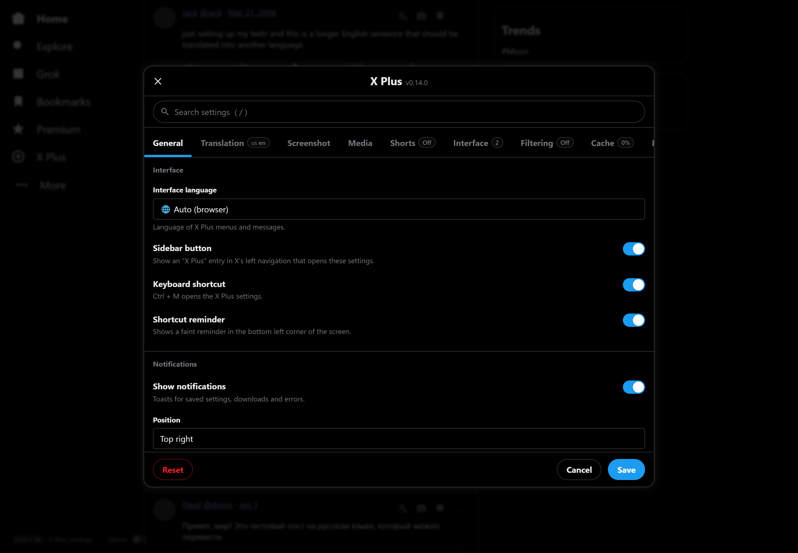
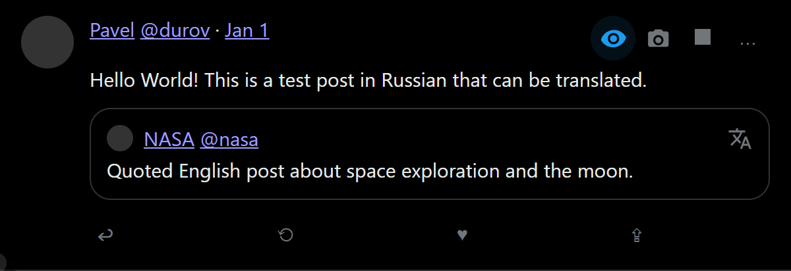
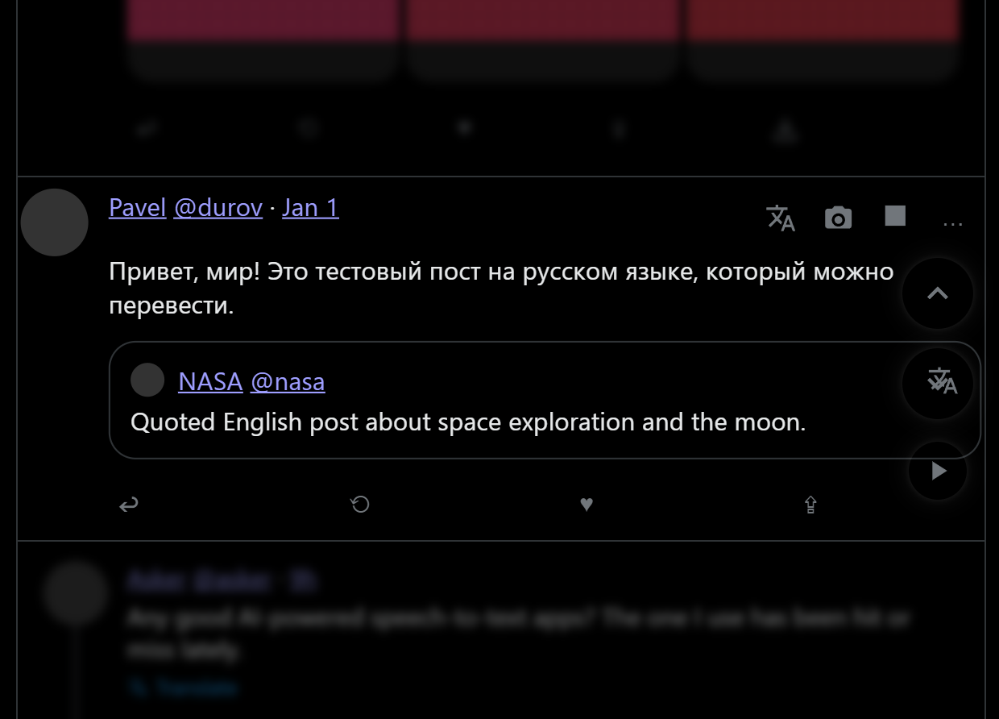
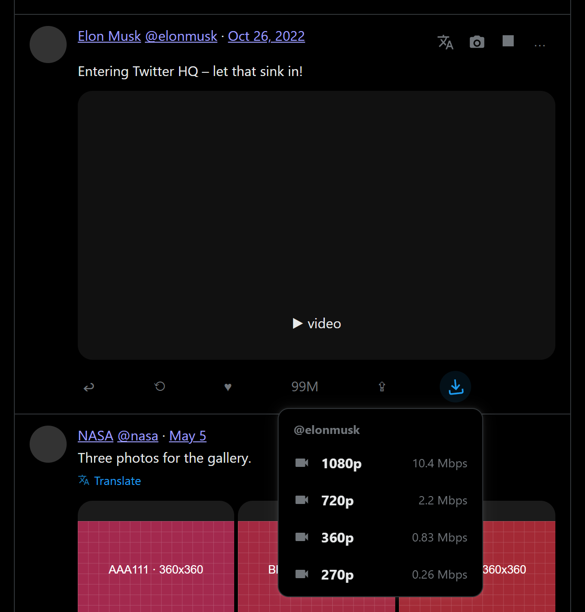
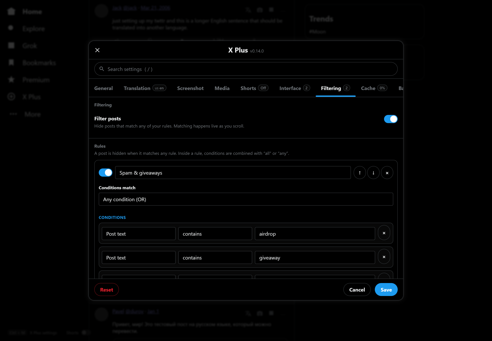

# X Plus

<!-- xp:readme -->
[](https://github.com/NemoKing1210/x-plus/actions/workflows/ci.yml)
[](https://raw.githubusercontent.com/NemoKing1210/x-plus/main/x-plus.user.js)
[](https://github.com/NemoKing1210/x-plus/blob/main/LICENSE)
[](https://github.com/NemoKing1210/x-plus/blob/main/CHANGELOG.md)

[English](https://github.com/NemoKing1210/x-plus/blob/main/README.md) · [Русский](https://github.com/NemoKing1210/x-plus/blob/main/README.ru.md) · [中文](https://github.com/NemoKing1210/x-plus/blob/main/README.zh.md) · [Español](https://github.com/NemoKing1210/x-plus/blob/main/README.es.md) · [Português](https://github.com/NemoKing1210/x-plus/blob/main/README.pt.md) · **Deutsch** · [Français](https://github.com/NemoKing1210/x-plus/blob/main/README.fr.md) · [日本語](https://github.com/NemoKing1210/x-plus/blob/main/README.ja.md)
<!-- /xp:readme -->

Ein Userscript für [X](https://x.com) (x.com / twitter.com): Übersetzung von
Beiträgen direkt an Ort und Stelle (ein Port des Schwesterprojekts x-translator), Download von
Medien (Videos, GIFs, Fotos) und eine Reihe von Oberflächen-Aufräumregeln — alles
in einem Einstellungsfenster, das dem hellen, gedimmten und dunklen Thema von X
folgt.

> Nicht mit X Corp. / Twitter verbunden.

## Screenshots

Aufgenommen mit dem gebauten Userscript im lokalen X-Teststand des Projekts
(Mock-Beiträge).



| | |
|---|---|
| <br>**Übersetzung** — an Ort und Stelle, mit *Original anzeigen*, Kamera-Schaltfläche und übersetztem Zitat | <br>**Shorts** — ein Beitrag auf einmal, Pfeiltasten, unscharfe Nachbarn |
| <br>**Medien-Download** — jede Fassung mit Bitrate, oder beste / Auflösungsgrenze / kleinste | <br>**Filterung** — ein Regel-Builder mit Bedingungen für Autor, Text, Sprache, Medien und Merkmale |

Außerdem: X-Artikel Absatz für Absatz übersetzt, Beiträge als PNG in der
Zwischenablage, schnelle Foto-Galerie und Vorschau jeder Aufräumregel beim
Darüberfahren.

## Installation

1. Installiere einen Userscript-Manager: [Tampermonkey](https://www.tampermonkey.net/),
   [Violentmonkey](https://violentmonkey.github.io/) oder
   [ScriptCat](https://scriptcat.org/).
2. Installiere das Skript über die Raw-URL (es aktualisiert sich selbst von
   `main`):

```
https://raw.githubusercontent.com/NemoKing1210/x-plus/main/x-plus.user.js
```

| Manager | Weg |
|---------|-----|
| Tampermonkey | Dashboard → **Dienstprogramme** → **Von URL installieren** |
| Violentmonkey | Dashboard → **+** → **Von URL installieren** |
| ScriptCat | **Von URL installieren** mit der Raw-URL |
| Manuell | `x-plus.user.js` öffnen, kopieren, neues Skript anlegen und einfügen |

Die Einstellungen öffnest du über den Eintrag **X Plus** im linken Menü von X
oder über das Menü des Userscript-Managers.

## Funktionen

### Übersetzung

Dieselbe Engine wie in [x-translator](https://github.com/NemoKing1210/x-translator):

- Schaltfläche **Übersetzen** in der Kopfzeile jedes Beitrags, jeder Antwort und
  jedes zitierten Beitrags
- **X-Artikel**: Die Schaltfläche Übersetzen in der Kopfzeile des Artikels
  (neben Grok) übersetzt ihn Absatz für Absatz (inklusive Titel, Listen und
  Bildunterschriften) — Links, Zeilenumbrüche und fette Zwischenüberschriften
  bleiben erhalten; die Übersetzung erscheint unter jedem Absatz oder an dessen
  Stelle
- Modi — auf Klick oder **automatisch**, sobald ein Beitrag sichtbar ist
  (optional nur für ausgewählte Konten)
- Anzeige — **Text ersetzen** (Standard) oder ein separates Fenster mit
  *Original anzeigen*, *Original beim Überfahren einblenden* oder einer
  *geteilten* Ansicht aus Original + Übersetzung
- Anbieter — Google (ohne Schlüssel), DeepL, Microsoft, OpenAI-kompatibel,
  Yandex, LibreTranslate
- Blockliste pro Konto, Erlaubt- / Blockiert-Listen für Ausgangssprachen,
  Beiträge überspringen, die X bereits selbst übersetzt hat, Einträge im
  ⋮-Menü des Beitrags
- Übersetzungsfehler („Übersetzung fehlgeschlagen. Versuche es erneut.“) sind
  standardmäßig ausgeblendet — ein Schalter holt sie zurück
- Links und Emojis bleiben heil: URLs und Hashtags überstehen die Übersetzung
- Lokaler Cache mit TTL, Nutzungsanzeige und weichem Größenlimit

### Screenshots

- Kamera-Schaltfläche neben **Übersetzen** in der Kopfzeile des Beitrags: Ein
  Klick kopiert den Beitrag — so wie er auf der Seite aussieht, inklusive
  aktuellem Thema, übersetztem Text, Medien, Zitat und Aktionsleiste — als PNG
  in die Zwischenablage
- Der Hintergrund ist einstellbar: Seitenthema (Standard, damit das PNG nie
  transparent ist), Weiß, Schwarz, transparent oder eine beliebige CSS-Farbe
- Bildskalierung (automatisch, 1×, 2×, 3×), Aktionsleiste behalten oder
  abschneiden, in die Zwischenablage kopieren oder als Datei speichern
- Videos und GIFs werden als Standbild der Vorschau erfasst
- Wenn der Browser keine Bilder in die Zwischenablage legen kann (Firefox), wird
  das PNG stattdessen als Datei gespeichert
- Standardmäßig aus

### Medien-Download

- Schaltfläche in der Aktionsleiste des Beitrags und (optional) über jedem
  Video / Foto
- Videos, GIFs und Fotos; zitierte Beiträge inklusive
- Videoqualität: beste, bis 1080 / 720 / 480p, kleinste Datei oder **jedes Mal
  fragen** (die Auswahl listet jede Fassung mit ihrer Bitrate)
- Fotos in Original- oder großer Qualität; jedes Foto lässt sich speichern oder
  als PNG in die Zwischenablage kopieren; mehrere Dateien → fragen oder alle
  herunterladen
- Dateinamen-Vorlage: `{user}` `{id}` `{date}` `{time}` `{n}` `{quality}`
  `{type}` `{text}`
- Fortschritts-Hinweis; funktioniert ohne Anmeldung über X' öffentlichen
  Syndication-Endpunkt und greift für Beiträge, die er nicht liefert, auf deine
  Sitzung zurück
- Optional größere Fotos beim Durchsehen der Timeline; der Wechsel zurück auf
  „Standard“ (oder das Abschalten von Medien) stellt X' eigene Fassungen wieder
  her
- Fotogalerie (optional): Ein Klick auf ein Foto im Beitrag öffnet eine schnelle
  Vollbildgalerie statt X' Fotoseite — ohne Antworten oder Timeline; alle Fotos
  des Beitrags mit Miniaturen (die Leiste scrollt mit dem Mausrad), `←` / `→`,
  Wischen, Zoom, Download, Kopieren in die Zwischenablage und Original
  öffnen (Strg / Cmd / Umschalt + Klick öffnet weiterhin X' Viewer)
- Zoom im Foto-Viewer: Mausrad, Ziehen, Doppelklick, `+` / `-` / `0`, Pinch auf
  Touchscreens

### Shorts-Modus

Den Feed Beitrag für Beitrag durchblättern, wie bei YouTube Shorts (optional).

- Mausrad oder `↑` / `↓` (auch `J` / `K`) springen zum vorherigen / nächsten
  Beitrag und zentrieren ihn (`Leertaste` vorwärts, `Umschalt` + `Leertaste`
  zurück)
- Die automatische Übersetzung (Übersetzung → Automatikmodus) lässt sich auf den
  aktuellen Beitrag begrenzen — sie startet, wenn der Beitrag einen Moment in
  der Mitte steht, sodass übersprungene Beiträge keine API-Anfragen kosten; der
  nächste Beitrag kann im Voraus übersetzt werden (eine Anfrage, nichts wird
  gezeigt, bis du dort ankommst), damit der Wechsel sofort erfolgt (standardmäßig
  an; die Schaltfläche Übersetzen funktioniert weiterhin überall)
- Videos laufen nur im aktuellen Beitrag: Die in den Nachbarbeiträgen bleiben
  pausiert, und ein Video wird pausiert, wenn du seinen Beitrag verlässt (es
  läuft wieder, wenn du zurückkommst)
- Runde ↑ / ↓-Schaltflächen neben dem aktuellen Beitrag wechseln mit der Maus
- Beiträge, die durch eine Thread-Linie verbunden sind (eine Antwort unter ihrem
  Beitrag, ein eigener Thread), gelten als ein Beitrag: Sie werden gemeinsam
  hervorgehoben, zentriert und übersprungen
- Der aktuelle Beitrag wird etwas größer, die umliegenden werden unscharf; Größe,
  Unschärfe, Deckkraft des vorherigen / nächsten Beitrags und
  Übergangsgeschwindigkeit sind einstellbar
- Automatisches Scrollen (optional): wechselt nach einer festgelegten Zeit (1–60
  s) von selbst zum nächsten Beitrag; ein längerer Video-Beitrag bleibt stehen,
  bis das Video wirklich zu Ende gespielt ist (ein später Start, Puffern oder
  Springen können den Wechsel nicht verfrühen), und der Countdown wartet, solange
  der Zeiger auf den Pfeil-Schaltflächen ist. Das Pausieren des Videos pausiert
  den Countdown, das Pausieren des Auto-Scrolls pausiert das Video; Fortsetzen
  bringt beides zurück. Der Fortschritt ist ein Ring um die
  „Weiter“-Schaltfläche oder ein Balken über dem Beitrag, wenn die Schaltflächen
  ausgeblendet sind; die Anzeige lässt sich in den Einstellungen umschalten; die
  Wiedergabe- / Pause-Schaltfläche sitzt unter den Pfeilen, und eine Taste (`P`
  standardmäßig, in den Einstellungen änderbar) pausiert und setzt das
  Auto-Scrollen fort — neben dem Balken zeigt ein kleines Etikett die Taste; eine
  Pause wird gemerkt und bleibt daher nach dem Öffnen eines Beitrags und der
  Rückkehr oder einem Neuladen der Seite bestehen (Auto-Scrollen aus- und wieder
  einschalten startet es neu)
- Einschalten in den Einstellungen (Tab Shorts) oder über den Schalter neben dem
  `Ctrl + M`-Hinweis unten links
- Funktioniert in Feeds (Startseite, Profile, Suche, Listen), nicht auf der
  Beitragsseite; ein Beitrag, der höher als der Bildschirm ist, scrollt normal,
  bis sein Rand erreicht ist

### Oberfläche

Aufräumregeln per Schalter: beworbene Beiträge, Aufrufzahlen,
Verifizierungs-Abzeichen, Grok-Schaltflächen, das Beitragsfeld und die
Feed-Tabs, der Block *Wem folgen*, den X in die Timeline einfügt, die rechte
Spalte (Suche, Premium-Angebot, Trends, *Wem folgen*, Footer-Links), Einträge im
linken Menü (Logo, Entdecken, Benachrichtigungen, Chat, Anrufe, Grok, Verlauf,
Creator Studio, Premium, Beitrag-Schaltfläche, Kontomenü …) und die schwebenden
Grok- / Chat-Fenster. Fahre über eine Einstellung, um sie in der Vorschau zu
sehen: Abdunklung und Unschärfe blenden aus und das betroffene Element auf der
Seite hinter dem Fenster wird umrandet (auch wenn es gerade ausgeblendet ist).

Ist die Start-Einblendung unter Allgemein aktiviert, legt sie die Seite kurz
still, während die Einstellungen angewendet werden, danach erscheinen die
sichtbaren Beiträge einer nach dem anderen — Aufräumen und eingefügte
Bedienelemente springen nie plötzlich ins Bild. Die Einblendung ist
standardmäßig aus und respektiert `prefers-reduced-motion`.

Ein eigener Abschnitt **Beitrag** gestaltet einen einzelnen Beitrag und seine
Teile: Beiträge als Karten (Umriss, Füllung oder Schatten, einstellbarer
Eckenradius), Abstand zwischen Beiträgen, Innenabstand, keine Trennlinien,
Textgröße, Avatarform (Kreis, abgerundet oder Quadrat) sowie das Ausblenden von
Avataren, zitierten Beiträgen, Bildern, Videos, Linkvorschauen, Artikeln, dem
Hinweis „Ausgangssprache“, @Benutzernamen, der Aktionsleiste, Aufrufzahlen,
Verifizierungs-Abzeichen und der Grok-Schaltfläche.

### Filterung

Ein Regel-Editor zum Ausblenden von Beiträgen, die du nicht sehen willst,
getrennt vom Aufräumen der Oberfläche.

- Ein Beitrag wird ausgeblendet, wenn er auf **eine beliebige** Regel passt;
  innerhalb einer Regel werden Bedingungen mit **alle** (UND) oder **beliebige**
  (ODER) verknüpft
- Bedingungen für Autorname, @Benutzername, Beitragstext, Sprache, Medien (Foto,
  Video oder GIF), Anhänge (Linkkarte, zitierter Beitrag, Umfrage, Artikel) und
  Merkmale (beworben, verifizierter Autor, Repost- / angepinnter Kontext)
- Textoperatoren: enthält / enthält nicht, ganzes Wort, beginnt mit / endet mit,
  exakt / nicht exakt, leer / nicht leer, regulärer Ausdruck
- Emoji-fähig: Eine Flagge oder ein Emoji im Autornamen oder Beitragstext wird
  so abgeglichen, wie du sie siehst
- **Auf dieser Seite testen** umrandet und zählt die passenden Beiträge —
  einschließlich bereits ausgeblendeter — vor dem Speichern
- Das Ausblenden geschieht live beim Scrollen und entfernt die ganze
  Beitragszelle, sodass keine Lücke bleibt; der fokussierte Beitrag auf einer
  Beitragsseite wird nie ausgeblendet
- Hauptschalter und ein Schalter pro Regel

### Einstellungen

- Öffnen und schließen mit **Ctrl + M** (unten links steht ein dezenter Hinweis;
  abschaltbar unter Allgemein), über den Eintrag im linken Menü oder das Menü des
  Userscript-Managers
- Tabs: **Allgemein · Übersetzung (inkl. Anbieter) · Medien · Shorts ·
  Oberfläche · Filterung · Cache · Sicherung · Über**; Änderungen werden
  gesammelt und mit **Speichern** angewendet
- Sprachen der Oberfläche: English, Русский, 中文, Español, Português, Deutsch,
  Français, 日本語 (oder automatisch)
- Benachrichtigungen: an / aus, Ecke, Anzeigedauer
- **Sicherung:** alle Einstellungen als JSON exportieren / importieren, auf
  Standardwerte zurücksetzen

## Einschränkungen

- Bei der Artikelübersetzung bleiben Links, Zeilenumbrüche und **Zeilen** in
  Fett / Kursiv erhalten; fett oder kursiv gesetzte Wörter innerhalb eines Satzes
  erscheinen in der Übersetzung als normaler Text.
- Nur **MP4**-Fassungen lassen sich speichern. Videos, die X ausschließlich als
  HLS-Stream veröffentlicht, werden als nicht herunterladbar gemeldet.
- Der GraphQL-Fallback für eingeschränkte Beiträge hängt von X' interner API ab
  und kann brechen, wenn X sie ändert; der Hauptweg (Syndication) nicht.
- X ändert sein Markup oft. Wenn eine Schaltfläche, eine Ausblendregel oder eine
  Platzierung nicht mehr funktioniert, stehen die anzupassenden Selektoren in
  [docs/DEVELOPMENT.md](docs/DEVELOPMENT.md#verifying-x-selectors).
- Übersetzungsanfragen gehen von deinem Browser an den gewählten Anbieter
  (standardmäßig Google). API-Schlüssel bleiben im Speicher des Userscripts — sie
  sind im JSON-Export enthalten, halte diese Datei also privat.

## Entwicklung

```bash
npm install
npm run build      # Build + Aktualisierung von x-plus.user.js / x-plus.meta.js im Wurzelverzeichnis
npm run ci         # i18n- und README-Prüfung + Build + Artefakt-Prüfung
npm run harness    # nachgebaute x.com-Seite für manuelle Tests
```

Architektur, neue Funktion / Anbieter / Aufräumregel und die Release-Checkliste:
[docs/ARCHITECTURE.md](docs/ARCHITECTURE.md),
[docs/DEVELOPMENT.md](docs/DEVELOPMENT.md), [AGENTS.md](AGENTS.md).

## Lizenz

[MIT](LICENSE)
