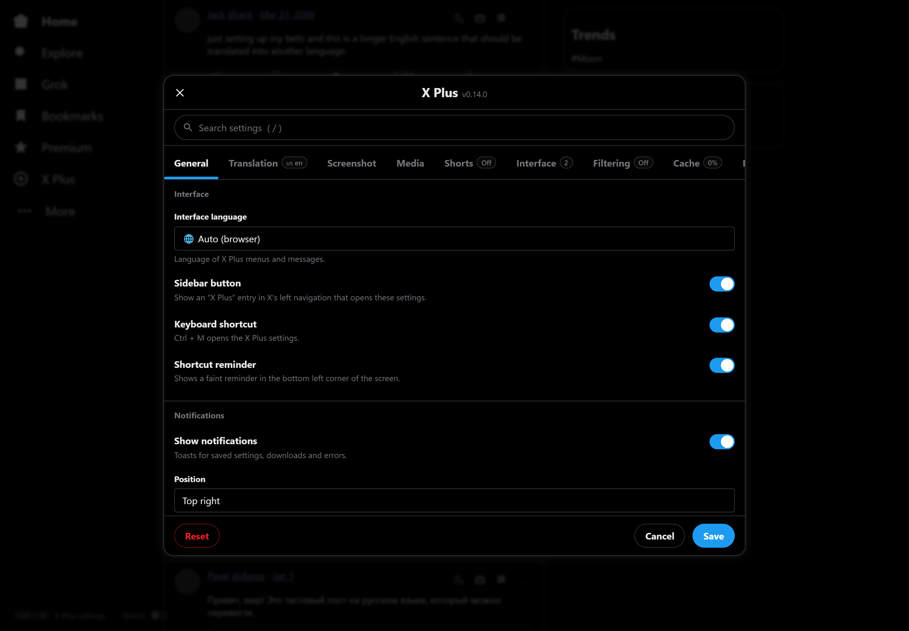
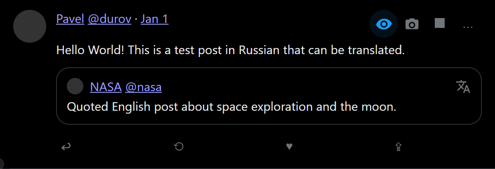
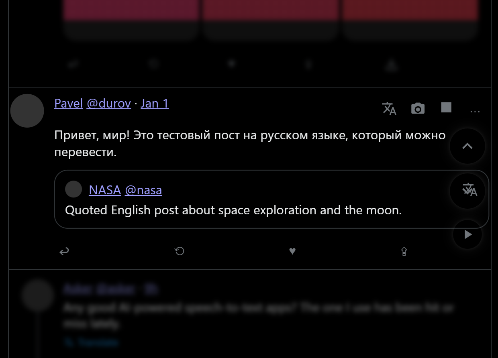
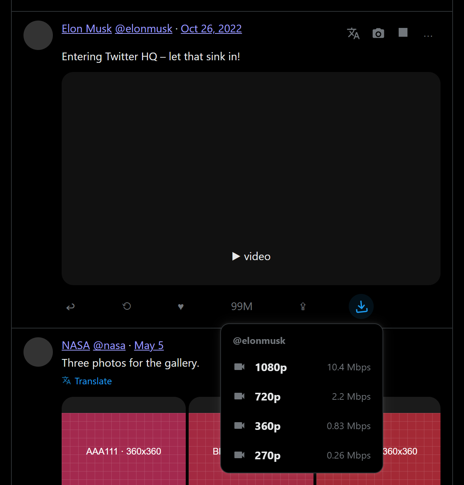
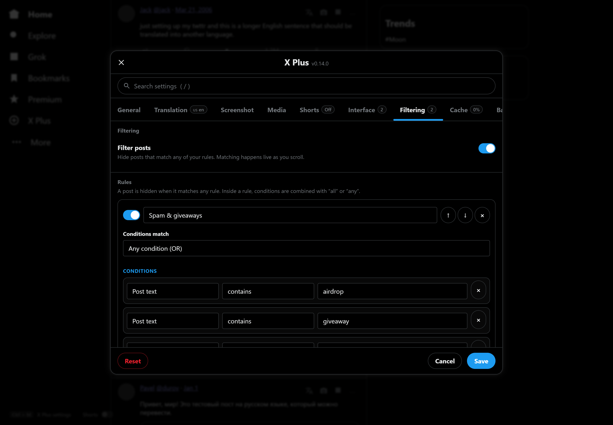

# X Plus

<!-- xp:readme -->
[](https://github.com/NemoKing1210/x-plus/actions/workflows/ci.yml)
[](https://raw.githubusercontent.com/NemoKing1210/x-plus/main/x-plus.user.js)
[](https://github.com/NemoKing1210/x-plus/blob/main/LICENSE)
[](https://github.com/NemoKing1210/x-plus/blob/main/CHANGELOG.md)

[English](https://github.com/NemoKing1210/x-plus/blob/main/README.md) · [Русский](https://github.com/NemoKing1210/x-plus/blob/main/README.ru.md) · [中文](https://github.com/NemoKing1210/x-plus/blob/main/README.zh.md) · **Español** · [Português](https://github.com/NemoKing1210/x-plus/blob/main/README.pt.md) · [Deutsch](https://github.com/NemoKing1210/x-plus/blob/main/README.de.md) · [Français](https://github.com/NemoKing1210/x-plus/blob/main/README.fr.md) · [日本語](https://github.com/NemoKing1210/x-plus/blob/main/README.ja.md)
<!-- /xp:readme -->

Un userscript para [X](https://x.com) (x.com / twitter.com) que añade
**traducción de publicaciones en el sitio**, **descarga de vídeos, GIF y fotos**
y una serie de **limpiezas de la interfaz**, todo configurable desde un único
panel que sigue el tema claro, atenuado y oscuro de X.

> No está afiliado a X Corp. / Twitter.

## Capturas

Realizadas con el userscript compilado en el banco de pruebas local de X
(publicaciones simuladas).



| | |
|---|---|
| <br>**Traducción** — en el sitio, con *Mostrar original*, el botón de cámara y la cita traducida | <br>**Shorts** — una publicación a la vez, botones de flecha, vecinas desenfocadas |
| <br>**Descarga de medios** — cada versión con su bitrate, o la mejor / un límite de resolución / la más ligera | <br>**Filtrado** — un constructor de reglas con condiciones sobre autor, texto, idioma, medios y marcas |

Además: artículos de X traducidos párrafo a párrafo, publicaciones copiadas al
portapapeles como PNG, galería rápida de fotos y vista previa de cada regla de
limpieza al pasar el ratón.

## Instalación

1. Instala un gestor de userscripts: [Tampermonkey](https://www.tampermonkey.net/),
   [Violentmonkey](https://violentmonkey.github.io/) o
   [ScriptCat](https://scriptcat.org/).
2. Instálalo desde la URL raw (el script se actualiza solo desde `main`):

```
https://raw.githubusercontent.com/NemoKing1210/x-plus/main/x-plus.user.js
```

| Gestor | Ruta |
|--------|------|
| Tampermonkey | Panel → **Utilidades** → **Instalar desde URL** |
| Violentmonkey | Panel → **+** → **Instalar desde URL** |
| ScriptCat | **Instalar desde URL** con la URL raw |
| Manual | Abre `x-plus.user.js`, cópialo, crea un script nuevo y pégalo |

Abre los ajustes desde la entrada **X Plus** del menú izquierdo de X o desde el
menú del gestor de userscripts.

## Funciones

### Traducción

El mismo motor que [x-translator](https://github.com/NemoKing1210/x-translator):

- Control **Traducir** en la cabecera de cada publicación, respuesta y cita
- **Artículos de X**: el botón Traducir de la cabecera del artículo (junto a
  Grok) lo traduce párrafo a párrafo (título, listas y pies de foto incluidos);
  los enlaces, los saltos de línea y los encabezados en negrita se conservan; se
  muestra bajo cada párrafo o en su lugar
- Modos: al pulsar el botón, o **automático** en cuanto una publicación es
  visible (opcionalmente solo para cuentas seleccionadas)
- Visualización: **sustituir** el texto en el sitio (por defecto), o un panel
  aparte con *Mostrar original*, *ver el original al pasar el ratón* o una vista
  *dividida* original + traducción
- Proveedores: Google (sin clave), DeepL, Microsoft, compatible con OpenAI,
  Yandex, LibreTranslate
- Lista de bloqueo por cuenta, listas de idiomas de origen permitidos y
  bloqueados, omitir publicaciones que X ya tradujo y entradas en el menú ⋮ de
  la publicación
- Los errores de traducción («No se pudo traducir. Inténtalo de nuevo.») se
  ocultan por defecto; un interruptor los vuelve a mostrar
- Enlaces y emojis intactos: las URL y los hashtags sobreviven a la traducción
- Caché local con TTL, medidor de uso y límite de tamaño flexible

### Capturas

- Botón de cámara junto a **Traducir** en la cabecera de la publicación: un clic
  copia la publicación —tal como se ve en la página, incluidos el tema actual,
  el texto traducido, los medios, la cita y la fila de acciones— al portapapeles
  como PNG
- El fondo se configura: el tema de la página (por defecto, para que el PNG nunca
  sea transparente), blanco, negro, transparente o cualquier color CSS
- Escala de la imagen (automática, 1×, 2×, 3×), conservar o recortar la fila de
  acciones, y copiar al portapapeles o guardar el archivo
- Los vídeos y GIF se capturan con su fotograma de portada
- Cuando el navegador no puede poner imágenes en el portapapeles (Firefox), el
  PNG se guarda como archivo
- Desactivado por defecto

### Descarga de medios

- Botón en la barra de acciones de la publicación y (opcionalmente) sobre cada
  vídeo o foto
- Vídeos, GIF y fotos; incluye las publicaciones citadas
- Calidad de vídeo: la mejor, hasta 1080 / 720 / 480p, el archivo más pequeño o
  **preguntar cada vez** (el selector muestra todas las versiones con su
  bitrate)
- Fotos en calidad original o grande; varios archivos → preguntar o descargar
  todos
- Plantilla de nombre de archivo: `{user}` `{id}` `{date}` `{time}` `{n}`
  `{quality}` `{type}` `{text}`
- Aviso de progreso; funciona sin iniciar sesión mediante el endpoint público
  de sindicación de X y recurre a tu sesión para las publicaciones que no
  devuelve
- Fotos más grandes al navegar por la cronología (opcional); volver a «predeterminado»
  (o desactivar los medios) restaura las versiones propias de X
- Galería de fotos (opcional): al hacer clic en una foto de la publicación se
  abre una galería a pantalla completa en lugar de la página de foto de X, sin
  cargar respuestas ni cronología; todas las fotos con miniaturas, `←` / `→`,
  deslizamiento, zoom, descarga y abrir original (Ctrl / Cmd / Mayús + clic
  siguen abriendo el visor de X)
- Zoom del visor de fotos: rueda, arrastre, doble clic, `+` / `-` / `0`, pellizco
  en pantallas táctiles

### Modo Shorts

Navega por el feed de una publicación en una, como YouTube Shorts (opcional).

- La rueda del ratón o `↑` / `↓` (también `J` / `K`) saltan a la publicación
  anterior o siguiente y la centran (`Espacio` avanza, `Mayús` + `Espacio`
  retrocede)
- La traducción automática (Traducción → modo automático) puede limitarse a la
  publicación actual: empieza cuando la publicación lleva un momento en el
  centro, así que las que pasas de largo no gastan solicitudes a la API; la
  siguiente puede traducirse por adelantado (una solicitud, nada se muestra
  hasta que llegas) para que el cambio sea instantáneo (activado por defecto; el
  botón Traducir sigue funcionando en todas partes)
- Los vídeos solo se reproducen en la publicación actual: los de las
  publicaciones vecinas permanecen en pausa, y un vídeo se pausa al alejarte de
  su publicación (se reanuda al volver)
- Botones redondos ↑ / ↓ junto a la publicación actual para cambiar con el ratón
- Las publicaciones unidas por la línea de hilo (una respuesta bajo su
  publicación, un hilo propio) cuentan como una sola: se resaltan, se centran y
  se recorren juntas
- La publicación actual crece un poco y las de alrededor se difuminan; el
  tamaño, el desenfoque, la opacidad de la anterior y la siguiente, y la
  velocidad de transición son ajustables
- Desplazamiento automático (opcional): pasa solo a la siguiente publicación tras
  un tiempo configurado (1–60 s); un vídeo más largo la retiene hasta que se ha
  reproducido de verdad hasta el final (un inicio tardío, el búfer o un salto no
  pueden hacer que se mueva antes), y la cuenta atrás espera mientras el puntero
  está sobre las flechas. Pausar el vídeo pausa la cuenta atrás, y pausar el
  desplazamiento pausa el vídeo; reanudar devuelve ambos. El progreso es un
  anillo alrededor del botón «siguiente», o una barra sobre la parte superior de
  la publicación cuando los botones están ocultos; el indicador se cambia en los
  ajustes; el botón de reproducir / pausar está bajo las flechas, y una tecla
  (`P` por defecto, configurable) pausa y reanuda el desplazamiento —junto a la
  barra, una pequeña etiqueta muestra la tecla—; la pausa se recuerda, así que se
  mantiene al abrir una publicación y volver o recargar la página (apagar y
  encender el desplazamiento automático lo vuelve a poner en marcha)
- Actívalo en los ajustes (pestaña Shorts) o con el interruptor junto al aviso
  de `Ctrl + M` en la esquina inferior izquierda
- Funciona en los feeds (Inicio, perfiles, búsqueda, listas), no en la página de
  una publicación; una publicación más alta que la pantalla se desplaza con
  normalidad hasta llegar a su borde

### Interfaz

Reglas de limpieza con interruptores: publicaciones promocionadas, recuentos de
vistas, insignias de verificación, botones de Grok, el cuadro de publicación y
las pestañas del feed, el bloque *A quién seguir* que X inserta en la cronología,
la columna derecha (búsqueda, oferta Premium, tendencias, *A quién seguir*,
enlaces del pie), entradas del menú izquierdo (logotipo, Explorar,
Notificaciones, Chat, Llamadas, Grok, Historial, Creator Studio, Premium, botón
de publicación, menú de cuenta…) y los paneles flotantes de Grok / Chat. Pasa el
ratón sobre un ajuste para previsualizarlo: la atenuación y el desenfoque se
desvanecen y el elemento afectado de la página detrás del panel se delinea (se
muestra aunque esté oculto).

Al iniciar el script, una breve introducción congela la página mientras se
aplican los ajustes y luego las publicaciones visibles aparecen una tras otra:
la limpieza y los controles inyectados nunca aparecen de golpe. Respeta la
preferencia `prefers-reduced-motion`.

Una sección **Publicación** aparte da estilo a una publicación y sus partes:
publicaciones como tarjetas (contorno, relleno o sombra, radio de esquina
ajustable), espacio entre publicaciones, relleno interior, sin separadores,
tamaño del texto, forma del avatar (círculo, redondeado o cuadrado) y ocultación
de avatares, publicaciones citadas, imágenes, vídeos, vistas previas de enlaces,
artículos, el aviso «Idioma de origen», @usuarios, la barra de acciones, los
recuentos de vistas, las insignias de verificación y el botón de Grok.

### Filtrado

Un creador de reglas para ocultar las publicaciones que no quieres ver, separado
de la limpieza de la interfaz.

- Una publicación se oculta cuando coincide con **cualquier** regla; dentro de
  una regla, las condiciones se combinan con **todas** (Y) o **cualquiera** (O)
- Condiciones sobre el nombre del autor, el @usuario, el texto, el idioma, los
  medios (foto, vídeo o GIF), los adjuntos (tarjeta de enlace, publicación
  citada, encuesta, artículo) y las marcas (promocionada, autor verificado,
  contexto de retuit / fijada)
- Operadores de texto: contiene / no contiene, palabra completa, empieza por /
  termina en, exactamente / no exactamente, vacío / no vacío, expresión regular
- Compatible con emojis: una bandera o un emoji en el nombre del autor o en el
  texto se compara tal como lo ves
- **Probar en esta página** delinea y cuenta las publicaciones coincidentes
  —incluidas las ya ocultas— antes de guardar
- El ocultado ocurre al desplazarte y elimina toda la celda de la publicación,
  sin dejar huecos; la publicación destacada en su página nunca se oculta
- Interruptor general y un interruptor por regla

### Ajustes

- Ábrelos y ciérralos con **Ctrl + M** (un recordatorio tenue aparece en la
  esquina inferior izquierda; se desactiva en General), desde la entrada del
  menú izquierdo o desde el menú del gestor de userscripts
- Pestañas: **General · Traducción (incl. proveedor) · Multimedia · Shorts ·
  Interfaz · Filtrado · Caché · Copia de seguridad · Acerca de**; los cambios se
  preparan y se aplican al pulsar **Guardar**
- Idiomas de la interfaz: English, Русский, 中文, Español, Português, Deutsch,
  Français, 日本語 (o automático)
- Notificaciones: activadas / desactivadas, esquina, duración
- **Copia de seguridad:** exportar / importar todos los ajustes como JSON,
  restablecer los valores predeterminados

## Limitaciones

- La traducción de artículos conserva enlaces, saltos de línea y **líneas** en
  negrita / cursiva; las palabras en negrita o cursiva dentro de una frase se
  muestran como texto normal en la traducción.
- Solo se pueden guardar versiones **MP4**. Los vídeos que X publica únicamente
  como flujo HLS se indican como no descargables.
- El recurso GraphQL para publicaciones restringidas depende de la API interna
  de X y puede dejar de funcionar cuando X la cambie; la ruta principal
  (sindicación) no.
- X cambia su estructura a menudo. Si un botón, una regla de ocultación o una
  posición dejan de funcionar, los selectores que hay que ajustar están en
  [docs/DEVELOPMENT.md](docs/DEVELOPMENT.md#verifying-x-selectors).
- Las solicitudes de traducción van al proveedor que elijas (Google por defecto)
  desde tu navegador. Las claves de API se quedan en el almacenamiento del
  userscript —se incluyen en la exportación JSON, así que mantén ese archivo
  privado.

## Desarrollo

```bash
npm install
npm run build      # compila y actualiza x-plus.user.js / x-plus.meta.js en la raíz
npm run ci         # comprobación de i18n y README + compilación + verificación de artefactos
npm run harness    # página simulada de x.com para pruebas manuales
```

Arquitectura, cómo añadir una función / proveedor / regla de limpieza y la lista
de comprobación de publicación: [docs/ARCHITECTURE.md](docs/ARCHITECTURE.md),
[docs/DEVELOPMENT.md](docs/DEVELOPMENT.md), [AGENTS.md](AGENTS.md).

## Licencia

[MIT](LICENSE)
