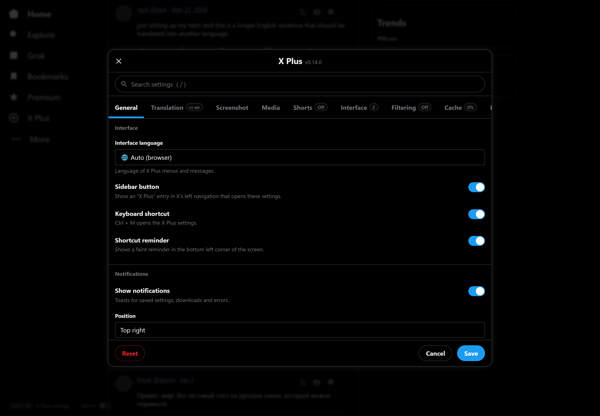
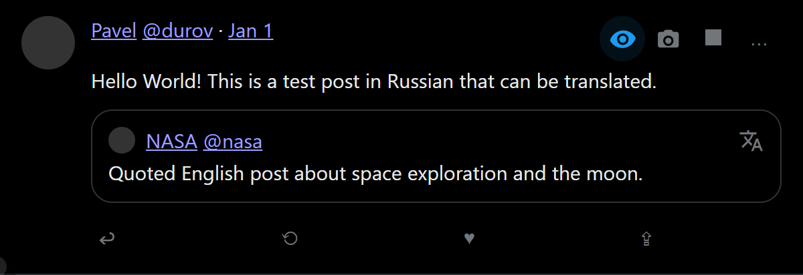
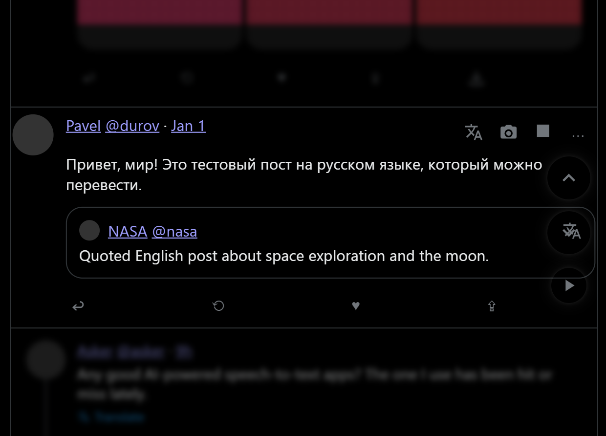
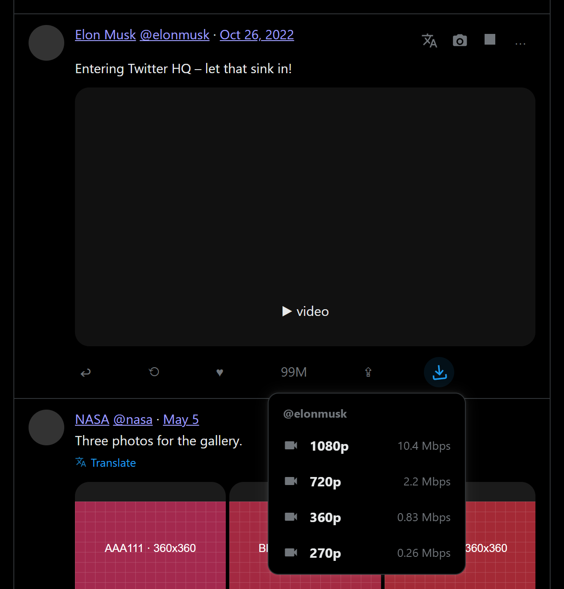
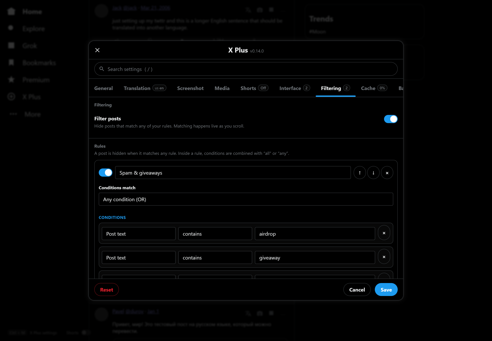

# X Plus

<!-- xp:readme -->
[](https://github.com/NemoKing1210/x-plus/actions/workflows/ci.yml)
[](https://raw.githubusercontent.com/NemoKing1210/x-plus/main/x-plus.user.js)
[](https://github.com/NemoKing1210/x-plus/blob/main/LICENSE)
[](https://github.com/NemoKing1210/x-plus/blob/main/CHANGELOG.md)

[English](https://github.com/NemoKing1210/x-plus/blob/main/README.md) · [Русский](https://github.com/NemoKing1210/x-plus/blob/main/README.ru.md) · [中文](https://github.com/NemoKing1210/x-plus/blob/main/README.zh.md) · [Español](https://github.com/NemoKing1210/x-plus/blob/main/README.es.md) · **Português** · [Deutsch](https://github.com/NemoKing1210/x-plus/blob/main/README.de.md) · [Français](https://github.com/NemoKing1210/x-plus/blob/main/README.fr.md) · [日本語](https://github.com/NemoKing1210/x-plus/blob/main/README.ja.md)
<!-- /xp:readme -->

Um userscript para o [X](https://x.com) (x.com / twitter.com) que adiciona
**tradução de posts no lugar**, **download de mídia** (vídeos, GIFs e fotos) e
uma série de **limpezas da interface** — tudo configurável em um único painel
que acompanha os temas claro, esmaecido e escuro do X.

> Não afiliado ao X Corp. / Twitter.

## Capturas de tela

Feitas com o userscript compilado no ambiente local de testes do X
(publicações simuladas).



| | |
|---|---|
| <br>**Tradução** — no lugar, com *Mostrar original*, o botão de câmera e a citação traduzida | <br>**Shorts** — uma publicação por vez, botões de seta, vizinhas desfocadas |
| <br>**Download de mídia** — cada versão com sua taxa de bits, ou a melhor / um limite de resolução / a menor | <br>**Filtragem** — um construtor de regras com condições de autor, texto, idioma, mídia e sinalizadores |

Também: artigos do X traduzidos parágrafo a parágrafo, uma publicação copiada
para a área de transferência como PNG, galeria rápida de fotos e prévia de cada
regra de limpeza ao passar o mouse.

## Instalação

1. Instale um gerenciador de userscripts: [Tampermonkey](https://www.tampermonkey.net/),
   [Violentmonkey](https://violentmonkey.github.io/) ou
   [ScriptCat](https://scriptcat.org/).
2. Instale pela URL raw (o script se atualiza sozinho a partir da `main`):

```
https://raw.githubusercontent.com/NemoKing1210/x-plus/main/x-plus.user.js
```

| Gerenciador | Caminho |
|-------------|---------|
| Tampermonkey | Painel → **Utilitários** → **Instalar de URL** |
| Violentmonkey | Painel → **+** → **Instalar de URL** |
| ScriptCat | **Instalar de URL** com a URL raw |
| Manual | Abra `x-plus.user.js`, copie, crie um novo script e cole |

Abra as configurações pelo item **X Plus** no menu esquerdo do X ou pelo menu do
gerenciador de userscripts.

## Recursos

### Tradução

O mesmo motor do [x-translator](https://github.com/NemoKing1210/x-translator):

- Controle **Traduzir** no cabeçalho de cada post, resposta e post citado
- **Artigos do X**: o botão Traduzir no cabeçalho do artigo (ao lado do Grok)
  traduz parágrafo a parágrafo (título, listas e legendas incluídos) — links,
  quebras de linha e títulos em negrito são preservados; aparece abaixo de cada
  parágrafo ou no lugar dele
- Modos — ao clicar no botão, ou **automático** assim que um post fica visível
  (opcionalmente apenas para contas selecionadas)
- Exibição — **substituir** o texto no lugar (padrão), ou um painel separado com
  *Mostrar original*, *espiar o original ao passar o mouse* ou uma visão
  *dividida* original + tradução
- Provedores — Google (sem chave), DeepL, Microsoft, compatível com OpenAI,
  Yandex, LibreTranslate
- Lista de bloqueio por conta, listas de idiomas de origem permitidos /
  bloqueados, ignorar posts que o X já traduziu e entradas no menu ⋮ do post
- Erros de tradução (“Não foi possível traduzir. Tente novamente.”) ficam
  ocultos por padrão — um interruptor os traz de volta
- Links e emojis preservados: URLs e hashtags sobrevivem à tradução intactos
- Cache local com TTL, medidor de uso e limite de tamanho flexível

### Capturas

- Botão de câmera ao lado de **Traduzir** no cabeçalho do post: um clique copia
  o post — como aparece na página, incluindo o tema atual, o texto traduzido, a
  mídia, a citação e a linha de ações — para a área de transferência como PNG
- O fundo é configurável: o tema da página (padrão, para que o PNG nunca seja
  transparente), branco, preto, transparente ou qualquer cor CSS
- Escala da imagem (automática, 1×, 2×, 3×), manter ou cortar a linha de ações,
  e copiar para a área de transferência ou salvar o arquivo
- Vídeos e GIFs são capturados pelo quadro de capa
- Quando o navegador não consegue colocar imagens na área de transferência
  (Firefox), o PNG é salvo como arquivo
- Desativado por padrão

### Download de mídia

- Botão na barra de ações do post e (opcionalmente) sobre cada vídeo / foto
- Vídeos, GIFs e fotos; posts citados incluídos
- Qualidade do vídeo: melhor, até 1080 / 720 / 480p, menor arquivo ou
  **perguntar sempre** (o seletor lista todas as versões com seu bitrate)
- Fotos em qualidade original ou grande; vários arquivos → perguntar ou baixar
  todos
- Modelo de nome de arquivo: `{user}` `{id}` `{date}` `{time}` `{n}` `{quality}`
  `{type}` `{text}`
- Aviso de progresso; funciona sem login pelo endpoint público de sindicação do
  X e recorre à sua sessão para posts que ele não retorna
- Fotos maiores ao navegar pela linha do tempo (opcional); voltar para “padrão”
  (ou desativar a mídia) restaura as versões próprias do X
- Galeria de fotos (opcional): um clique em uma foto do post abre uma galeria
  em tela cheia em vez da página de foto do X — sem respostas ou linha do tempo;
  todas as fotos do post com miniaturas, `←` / `→`, deslize, zoom, download e
  abrir original (Ctrl / Cmd / Shift + clique ainda abrem o visualizador do X)
- Zoom do visualizador de fotos: roda, arrastar, clique duplo, `+` / `-` / `0`,
  pinça em telas de toque

### Modo Shorts

Navegue pelo feed um post por vez, como o YouTube Shorts (opcional).

- A roda do mouse ou `↑` / `↓` (também `J` / `K`) vão para o post anterior /
  seguinte e o centralizam (`Espaço` avança, `Shift` + `Espaço` volta)
- A tradução automática (Tradução → modo automático) pode ser limitada ao post
  atual — ela começa quando o post fica um momento no centro, então os posts que
  você passa não gastam requisições à API; o próximo post pode ser traduzido
  antecipadamente (uma requisição, nada é mostrado até você chegar) para a troca
  ser instantânea (ativado por padrão; o botão Traduzir continua funcionando em
  todos os lugares)
- Vídeos tocam apenas no post atual: os dos posts vizinhos ficam pausados, e um
  vídeo é pausado quando você sai do post dele (volta a tocar quando você
  retorna)
- Botões redondos ↑ / ↓ ao lado do post atual alternam os posts com o mouse
- Posts unidos pela linha de thread (uma resposta abaixo do post, uma thread
  própria) contam como um só: são destacados, centralizados e percorridos juntos
- O post atual cresce um pouco e os ao redor ficam desfocados; tamanho,
  desfoque, opacidade do anterior / seguinte e velocidade da transição são
  ajustáveis
- Rolagem automática (opcional): passa sozinha para o próximo post após um tempo
  definido (1–60 s); um vídeo mais longo segura o post até ter realmente
  reproduzido até o fim (um início tardio, buffering ou um avanço não fazem a
  rolagem pular antes), e a contagem espera enquanto o ponteiro está nos botões
  de seta. Pausar o vídeo pausa a contagem, e pausar a rolagem pausa o vídeo;
  retomar traz os dois de volta. O progresso é um anel ao redor do botão
  “próximo”, ou uma barra no topo do post quando os botões estão ocultos; o
  indicador pode ser trocado nas configurações; o botão de reproduzir / pausar
  fica sob as setas, e uma tecla (`P` por padrão, alterável nas configurações)
  pausa e retoma a rolagem — ao lado da barra, uma pequena etiqueta mostra a
  tecla; a pausa é lembrada, então permanece após abrir um post e voltar ou
  recarregar a página (desligar e ligar a rolagem automática a inicia novamente)
- Ative nas configurações (aba Shorts) ou com o interruptor ao lado do lembrete
  de `Ctrl + M` no canto inferior esquerdo
- Funciona nos feeds (Início, perfis, busca, listas), não na página de um post;
  um post mais alto que a tela rola normalmente até chegar à borda

### Interface

Regras de limpeza com interruptores: posts promovidos, contagens de
visualizações, selos de verificação, botões do Grok, a caixa de postagem e as
abas do feed, o bloco *Quem seguir* que o X insere na linha do tempo, a coluna
direita (busca, oferta Premium, tendências, *Quem seguir*, links do rodapé),
itens do menu esquerdo (logotipo, Explorar, Notificações, Chat, Chamadas, Grok,
Histórico, Creator Studio, Premium, botão de postar, menu da conta…) e os
painéis flutuantes do Grok / Chat. Passe o mouse sobre uma configuração para
visualizá-la: o escurecimento e o desfoque desaparecem e o elemento afetado na
página atrás do painel é contornado (mostrado mesmo se estiver oculto).

Quando o script inicia, uma breve introdução congela a página enquanto as
configurações são aplicadas, e então os posts na tela aparecem um após o outro —
a limpeza e os controles injetados nunca surgem de repente. Respeita a
preferência `prefers-reduced-motion`.

Uma seção **Post** separada estiliza um post e suas partes: posts como cartões
(contorno, preenchimento ou sombra, raio dos cantos ajustável), espaço entre
posts, preenchimento interno, sem divisores, tamanho do texto, formato do avatar
(círculo, arredondado ou quadrado) e ocultação de avatares, posts citados,
imagens, vídeos, prévias de links, artigos, o aviso “Idioma de origem”,
@identificadores, a barra de ações, contagens de visualizações, selos de
verificação e o botão do Grok.

### Filtragem

Um construtor de regras para ocultar posts que você não quer ver, separado da
limpeza da interface.

- Um post é ocultado quando corresponde a **qualquer** regra; dentro de uma
  regra, as condições são combinadas com **todas** (E) ou **qualquer** (OU)
- Condições sobre o nome do autor, @identificador, texto do post, idioma, mídia
  (foto, vídeo ou GIF), anexos (cartão de link, post citado, enquete, artigo) e
  marcadores (promovido, autor verificado, contexto de repost / fixado)
- Operadores de texto: contém / não contém, palavra inteira, começa com /
  termina com, exatamente / não exatamente, vazio / não vazio, expressão
  regular
- Compatível com emojis: uma bandeira ou emoji no nome do autor ou no texto é
  comparado como você o vê
- **Testar nesta página** contorna e conta os posts correspondentes — incluindo
  os já ocultos — antes de salvar
- A ocultação acontece ao vivo durante a rolagem e remove toda a célula do post,
  sem deixar espaço vazio; o post em destaque na página de post nunca é oculto
- Interruptor geral e um interruptor por regra

### Configurações

- Abra e feche com **Ctrl + M** (um lembrete discreto fica no canto inferior
  esquerdo; pode ser desativado em Geral), pelo item do menu esquerdo ou pelo
  menu do gerenciador de userscripts
- Abas: **Geral · Tradução (incl. provedor) · Mídia · Shorts · Interface ·
  Filtragem · Cache · Backup · Sobre**; as alterações são preparadas e aplicadas
  ao clicar em **Salvar**
- Idiomas da interface: English, Русский, 中文, Español, Português, Deutsch,
  Français, 日本語 (ou automático)
- Notificações: ativadas / desativadas, canto, duração
- **Backup:** exportar / importar todas as configurações em JSON, restaurar os
  padrões

## Limitações

- A tradução de artigos preserva links, quebras de linha e **linhas** em negrito
  / itálico; palavras em negrito ou itálico dentro de uma frase são exibidas
  como texto simples na tradução.
- Apenas versões **MP4** podem ser salvas. Vídeos que o X publica somente como
  stream HLS são informados como não baixáveis.
- O recurso GraphQL para posts restritos depende da API interna do X e pode
  parar de funcionar quando o X a alterar; o caminho principal (sindicação) não.
- O X muda sua estrutura com frequência. Se um botão, regra de ocultação ou
  posição parar de funcionar, os seletores a ajustar estão em
  [docs/DEVELOPMENT.md](docs/DEVELOPMENT.md#verifying-x-selectors).
- As requisições de tradução vão para o provedor escolhido (Google por padrão) a
  partir do seu navegador. As chaves de API ficam no armazenamento do userscript
  — elas são incluídas na exportação JSON, então mantenha esse arquivo privado.

## Desenvolvimento

```bash
npm install
npm run build      # compila + atualiza x-plus.user.js / x-plus.meta.js na raiz
npm run ci         # verificação de i18n e README + build + verificação de artefatos
npm run harness    # página simulada do x.com para testes manuais
```

Arquitetura, como adicionar um recurso / provedor / regra de limpeza e a
checklist de lançamento: [docs/ARCHITECTURE.md](docs/ARCHITECTURE.md),
[docs/DEVELOPMENT.md](docs/DEVELOPMENT.md), [AGENTS.md](AGENTS.md).

## Licença

[MIT](LICENSE)
