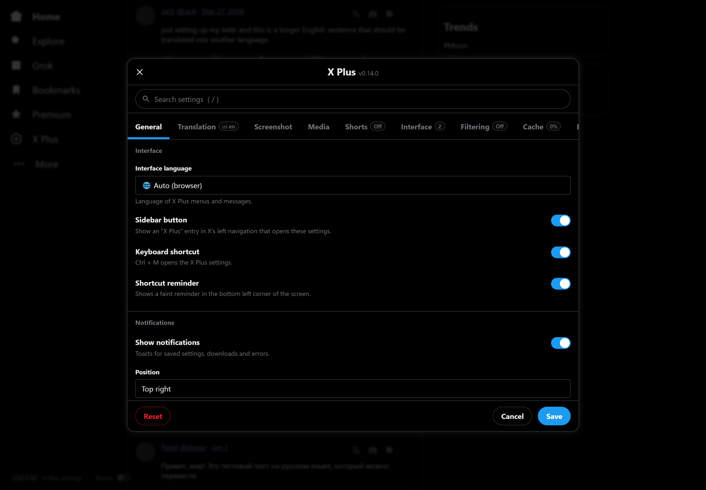
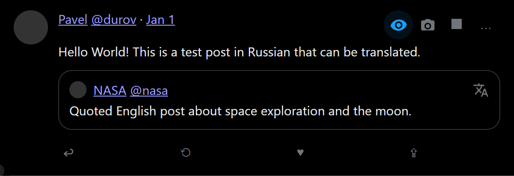
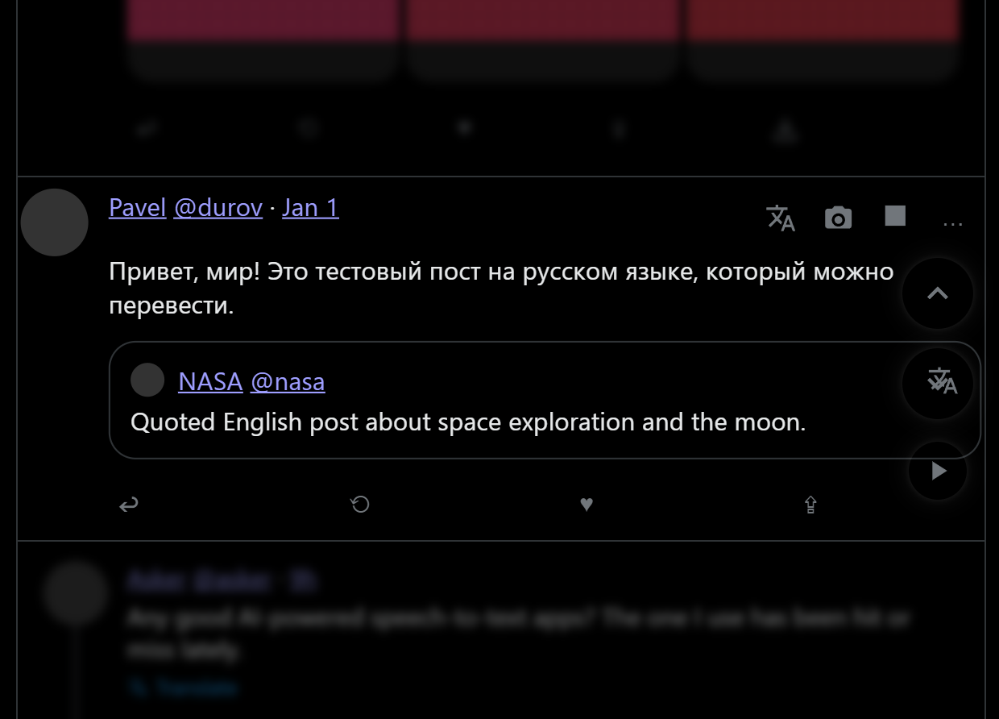
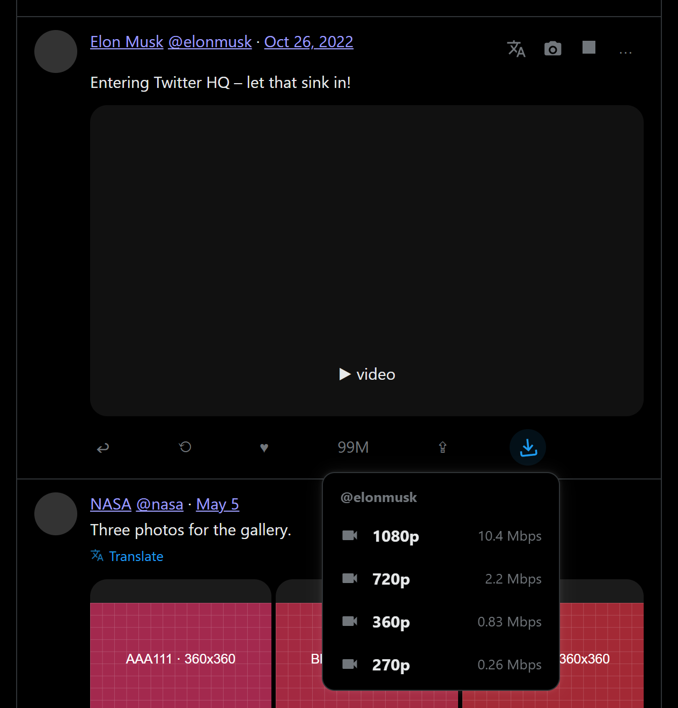
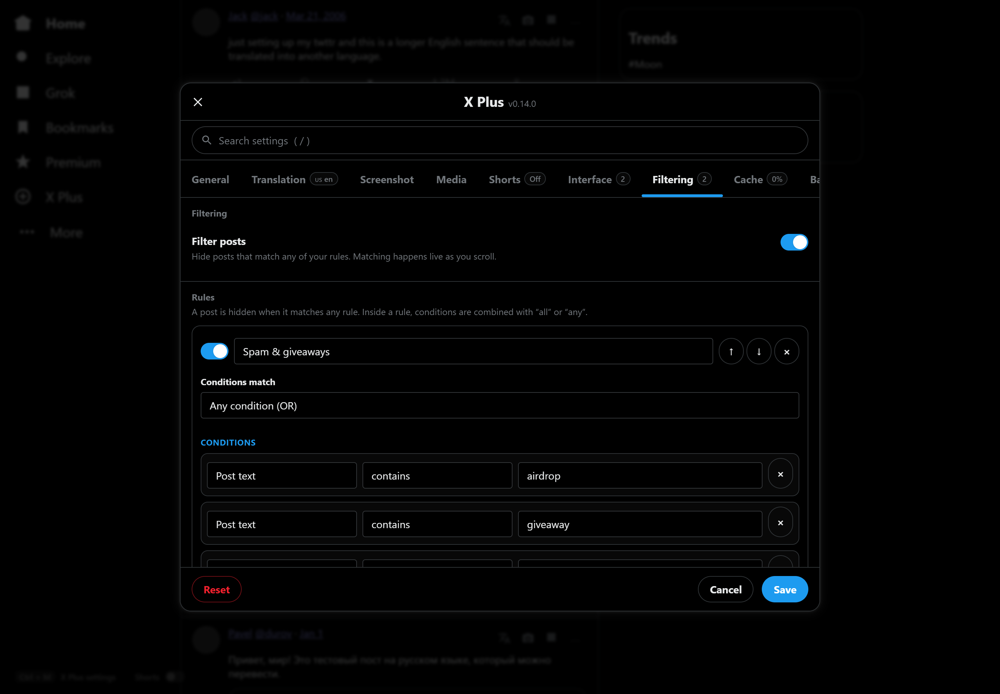

# X Plus

<!-- xp:readme -->
[](https://github.com/NemoKing1210/x-plus/actions/workflows/ci.yml)
[](https://raw.githubusercontent.com/NemoKing1210/x-plus/main/x-plus.user.js)
[](https://github.com/NemoKing1210/x-plus/blob/main/LICENSE)
[](https://github.com/NemoKing1210/x-plus/blob/main/CHANGELOG.md)

[English](https://github.com/NemoKing1210/x-plus/blob/main/README.md) · **Русский** · [中文](https://github.com/NemoKing1210/x-plus/blob/main/README.zh.md) · [Español](https://github.com/NemoKing1210/x-plus/blob/main/README.es.md) · [Português](https://github.com/NemoKing1210/x-plus/blob/main/README.pt.md) · [Deutsch](https://github.com/NemoKing1210/x-plus/blob/main/README.de.md) · [Français](https://github.com/NemoKing1210/x-plus/blob/main/README.fr.md) · [日本語](https://github.com/NemoKing1210/x-plus/blob/main/README.ja.md)
<!-- /xp:readme -->

Юзерскрипт для [X](https://x.com) (x.com / twitter.com): перевод постов прямо
на странице (порт соседнего проекта x-translator), скачивание медиа
(видео, GIF, фото) и очистка интерфейса — всё в одной панели настроек.

> Не связан с X Corp. / Twitter.

## Скриншоты

Снято со встроенного скрипта на локальном X-стенде проекта (моковые посты).



| | |
|---|---|
| <br>**Перевод** — на месте, с *«Показать оригинал»*, кнопкой камеры и переводом цитаты | <br>**Shorts** — по одному посту, кнопки-стрелки, размытые соседние посты |
| <br>**Скачивание медиа** — все варианты с битрейтом, либо лучший / с ограничением разрешения / самый лёгкий | <br>**Фильтрация** — конструктор правил с условиями по автору, тексту, языку, медиа и признакам |

Ещё: перевод статей X по абзацам, копирование поста в PNG, быстрая галерея
фото и предпросмотр любого правила очистки при наведении.

## Установка

1. Установите менеджер юзерскриптов — [Tampermonkey](https://www.tampermonkey.net/),
   [Violentmonkey](https://violentmonkey.github.io/) или
   [ScriptCat](https://scriptcat.org/).
2. Установите скрипт по raw-ссылке (он обновляется сам из ветки `main`):

```
https://raw.githubusercontent.com/NemoKing1210/x-plus/main/x-plus.user.js
```

| Менеджер | Как установить |
|----------|----------------|
| Tampermonkey | Панель управления → **Утилиты** → **Установить по URL** |
| Violentmonkey | Панель управления → **+** → **Установить по URL** |
| ScriptCat | **Установить по URL** с raw-ссылкой |
| Вручную | Откройте `x-plus.user.js`, скопируйте его, создайте новый скрипт и вставьте код |

Настройки открываются из пункта **X Plus** в левом меню X или из меню
менеджера юзерскриптов.

## Возможности

### Перевод

Тот же движок, что и в
[x-translator](https://github.com/NemoKing1210/x-translator):

- Кнопка **«Перевести»** в шапке каждого поста, ответа и цитируемого поста
- **Статьи X**: кнопка перевода в шапке статьи (рядом с Grok) переводит её
  абзац за абзацем (заголовок, списки и подписи к картинкам включены) — ссылки,
  переносы строк и жирные подзаголовки сохраняются; перевод показывается под
  каждым абзацем или вместо него
- Режимы — по нажатию кнопки или **автоматически**, как только пост появляется
  на экране (при желании только для выбранных аккаунтов)
- Отображение — **замена** текста на месте (по умолчанию) или отдельная панель
  с кнопками *Показать оригинал*, *показать оригинал при наведении* или
  *разделённый* вид «оригинал + перевод»
- Провайдеры — Google (без ключа), DeepL, Microsoft, OpenAI-совместимый, Yandex,
  LibreTranslate
- Чёрный список аккаунтов, списки разрешённых и запрещённых языков оригинала,
  пропуск постов, которые X уже перевёл сам, пункты в меню ⋮ поста
- Ошибки перевода («Не удалось перевести. Попробуйте ещё раз.») по умолчанию
  скрыты — переключатель возвращает их на экран
- Ссылки и эмодзи не ломаются: адреса и хэштеги переживают перевод без
  изменений
- Локальный кэш с TTL, индикатор использования и мягкий лимит размера

### Скриншоты

- Кнопка-камера рядом с **«Перевести»** в шапке поста: одно нажатие копирует
  пост — как он выглядит на странице, вместе с текущей темой, переведённым
  текстом, медиа, цитатой и панелью действий — в буфер обмена в виде PNG
- Фон настраивается: тема страницы (по умолчанию, поэтому PNG никогда не
  прозрачный), белый, чёрный, прозрачный или любой цвет CSS
- Масштаб изображения (авто, 1×, 2×, 3×), сохранение или обрезка панели
  действий, копирование в буфер обмена или сохранение файла
- Видео и GIF снимаются по кадру-обложке
- Если браузер не умеет класть изображения в буфер обмена (Firefox), PNG
  сохраняется как файл
- По умолчанию выключено

### Скачивание медиа

- Кнопка в панели действий поста и (по желанию) поверх каждого видео / фото
- Видео, GIF и фото; цитируемые посты включены
- Качество видео: лучшее, до 1080 / 720 / 480p, самый маленький файл или
  **спрашивать каждый раз** (в списке все варианты с битрейтом)
- Фото в оригинальном или крупном качестве; несколько файлов — спросить или
  скачать все
- Шаблон имени файла: `{user}` `{id}` `{date}` `{time}` `{n}` `{quality}`
  `{type}` `{text}`
- Индикатор прогресса; работает без входа через публичный syndication-эндпоинт
  X и переключается на вашу сессию для постов, которые он не отдаёт
- Крупные фото в ленте по желанию; возврат к «по умолчанию» (или отключение
  медиа) восстанавливает собственные варианты X
- Галерея фото (по желанию): клик по фото в посте открывает быструю
  полноэкранную галерею вместо страницы фото X — без ответов и ленты; все фото
  поста с миниатюрами, `←` / `→`, свайп, зум, скачивание и открытие оригинала
  (Ctrl / Cmd / Shift-клик по-прежнему открывает просмотрщик X)
- Зум в просмотрщике фото: колесо, перетаскивание, двойной клик, `+` / `-` /
  `0`, пинч на сенсорных экранах

### Режим «Шортс»

Лента по одному посту за раз, как YouTube Shorts (по желанию).

- Колесо мыши или `↑` / `↓` (а также `J` / `K`) переходят к предыдущему /
  следующему посту и центрируют его (`Space` — вперёд, `Shift` + `Space` —
  назад)
- Автоматический перевод (режим «авто» в разделе «Перевод») можно ограничить
  текущим постом — он запускается, когда пост задержался в центре, так что
  пропущенные посты не тратят запросы к API; следующий пост можно перевести
  заранее (один запрос, ничего не показывается, пока вы до него не дойдёте),
  поэтому текст меняется мгновенно (включено по умолчанию; кнопка «Перевести»
  работает везде)
- Видео играют только в текущем посте: видео в соседних постах остаются на
  паузе, а видео ставится на паузу, когда вы уходите с его поста (и снова
  играет, когда возвращаетесь)
- Круглые кнопки ↑ / ↓ рядом с текущим постом переключают посты мышью
- Посты, соединённые линией треда (ответ под постом, собственный тред),
  считаются одним постом: они подсвечиваются, центрируются и пропускаются
  вместе
- Текущий пост немного увеличивается, соседние размываются; размер, размытие,
  прозрачность предыдущего / следующего поста и скорость перехода настраиваются
- Автопрокрутка (по желанию): сама переходит к следующему посту через заданное
  время (1–60 с); видео длиннее этого времени удерживает свой пост, пока не
  проиграет до конца (поздний старт, буферизация или перемотка не могут
  заставить её прыгнуть раньше), а отсчёт ждёт, пока указатель на кнопках со
  стрелками. Пауза видео ставит на паузу отсчёт, а пауза автопрокрутки — видео;
  возобновление возвращает и то и другое. Прогресс показывается кольцом вокруг
  кнопки «дальше» или полосой в верхней части поста, когда кнопки скрыты;
  индикатор переключается в настройках; кнопка воспроизведения / паузы
  находится под стрелками, а клавиша (`P` по умолчанию, меняется в настройках)
  ставит автопрокрутку на паузу и возобновляет её — рядом с полосой небольшой
  значок показывает клавишу; пауза запоминается, поэтому сохраняется после
  открытия поста, возврата или перезагрузки страницы (выключение и включение
  автопрокрутки снова запускает её)
- Включается в настройках (вкладка «Шортс») или переключателем рядом с
  напоминанием о `Ctrl + M` в левом нижнем углу
- Работает в лентах (Главная, профили, поиск, списки), но не на странице поста;
  пост выше экрана прокручивается как обычно, пока не дойдёт до края

### Интерфейс

Правила очистки с переключателями: продвигаемые посты, счётчики просмотров,
значки верификации, кнопки Grok, окно публикации и вкладки ленты, блок
*Кого читать*, который X вставляет в ленту, правая колонка (поиск, предложение
Premium, тренды, *Кого читать*, ссылки в подвале), пункты левого меню (логотип,
Обзор, Уведомления, Чат, Звонки, Grok, История, Творческая студия, Premium,
кнопка публикации, меню учётной записи …) и плавающие панели Grok / Чата.
Наведите на настройку, чтобы увидеть её в действии: затемнение и размытие
исчезают, а затронутый элемент на странице за панелью обводится (показывается,
даже если сейчас скрыт).

Если в разделе «Общие» включена заставка при запуске, она ненадолго
замораживает страницу, пока применяются настройки, затем посты на экране
проявляются один за другим — очистка и добавленные элементы управления никогда
не появляются рывком. По умолчанию заставка выключена и соблюдает настройку
`prefers-reduced-motion`.

Отдельный раздел **«Пост»** оформляет один пост и его части: посты как
карточки (контур, заливка или тень, настраиваемый радиус углов), расстояние
между постами, внутренние отступы, отсутствие разделителей, размер текста,
форма аватара (круг, скруглённый квадрат или квадрат) и скрытие аватаров,
цитируемых постов, изображений, видео, превью ссылок, статей, уведомления
«Язык оригинала», @упоминаний, панели действий, счётчиков просмотров, значков
верификации и кнопки Grok.

### Фильтрация

Конструктор правил для скрытия постов, которые вы не хотите видеть, отдельно
от очистки интерфейса.

- Пост скрывается, когда совпадает с **любым** правилом; внутри правила
  условия объединяются через **все** (И) или **любое** (ИЛИ)
- Условия по имени автора, @упоминанию, тексту поста, языку, медиа (фото,
  видео или GIF), вложениям (карточка ссылки, цитируемый пост, опрос, статья)
  и признакам (продвигаемый пост, верифицированный автор, репост / закреплённый
  контекст)
- Операторы текста: содержит / не содержит, целое слово, начинается /
  заканчивается на, ровно / не ровно, пусто / не пусто, регулярное выражение
- Эмодзи учитываются: флаг или эмодзи в имени автора или тексте поста
  сопоставляется так, как вы его видите
- **Проверить на странице** обводит и считает подходящие посты — включая
  уже скрытые — до сохранения
- Скрытие происходит на лету при прокрутке и убирает всю ячейку поста, так что
  пустого промежутка не остаётся; пост, открытый на странице поста, не
  скрывается
- Общий переключатель и переключатель для каждого правила

### Настройки

- Открываются и закрываются по **Ctrl + M** (бледное напоминание висит в левом
  нижнем углу; отключается в разделе «Общие»), из пункта левого меню или из
  меню менеджера юзерскриптов
- Вкладки: **Общие · Перевод (включая провайдера) · Медиа · Шортс · Интерфейс ·
  Фильтрация · Кэш · Резервная копия · О скрипте**; изменения накапливаются и
  применяются по кнопке **«Сохранить»**
- Языки интерфейса: English, Русский, 中文, Español, Português, Deutsch,
  Français, 日本語 (или автоматически)
- Уведомления: включить / выключить, угол, время показа
- **Резервная копия:** экспорт и импорт всех настроек в JSON, сброс к значениям
  по умолчанию

## Ограничения

- При переводе статей сохраняются ссылки, переносы строк и **строки** с жирным
  и курсивом; жирные или курсивные слова внутри предложения в переводе
  отображаются обычным текстом.
- Сохранять можно только варианты **MP4**. Видео, которые X публикует только
  как HLS-поток, помечаются как недоступные для скачивания.
- Резервный путь через GraphQL для закрытых постов зависит от внутреннего API X
  и может сломаться, когда X его изменит; основной путь (syndication) — нет.
- X часто меняет разметку. Если кнопка, правило скрытия или размещение перестали
  работать, селекторы для правки перечислены в
  [docs/DEVELOPMENT.md](docs/DEVELOPMENT.md#verifying-x-selectors).
- Запросы на перевод уходят выбранному провайдеру (по умолчанию Google) из
  вашего браузера. API-ключи остаются в хранилище юзерскрипта — они попадают в
  JSON-экспорт, поэтому храните этот файл в тайне.

## Разработка

```bash
npm install
npm run build      # сборка + обновление x-plus.user.js / x-plus.meta.js в корне
npm run ci         # проверка i18n и README + сборка + проверка артефактов
npm run harness    # макет страницы x.com для ручного тестирования
```

Архитектура, добавление функции / провайдера / правила очистки и чек-лист
релиза: [docs/ARCHITECTURE.md](docs/ARCHITECTURE.md),
[docs/DEVELOPMENT.md](docs/DEVELOPMENT.md), [AGENTS.md](AGENTS.md).

## Лицензия

[MIT](LICENSE)
