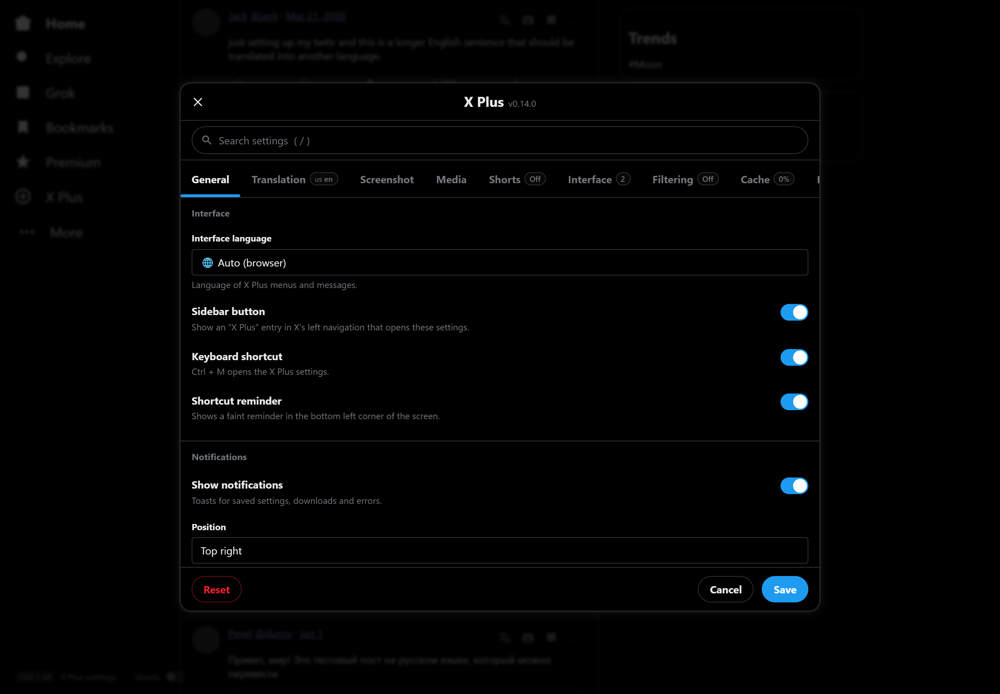
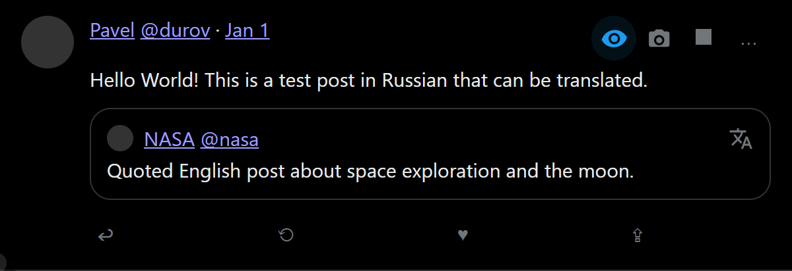
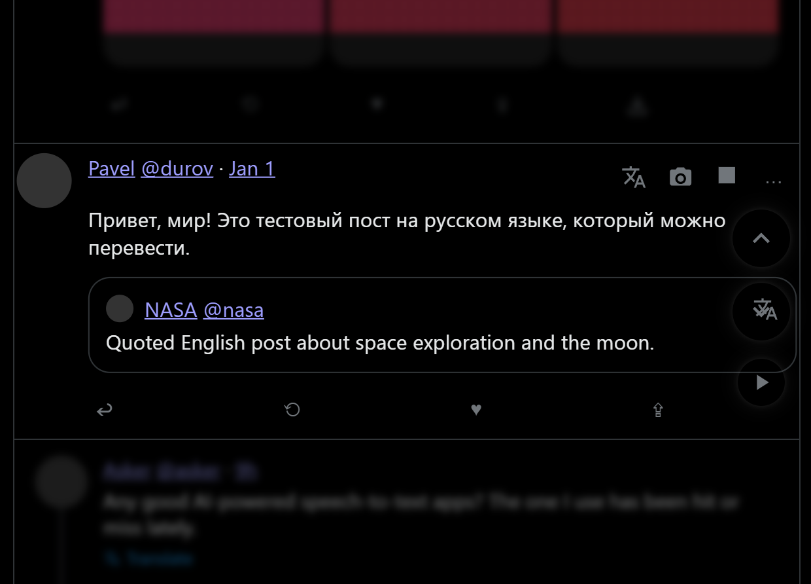
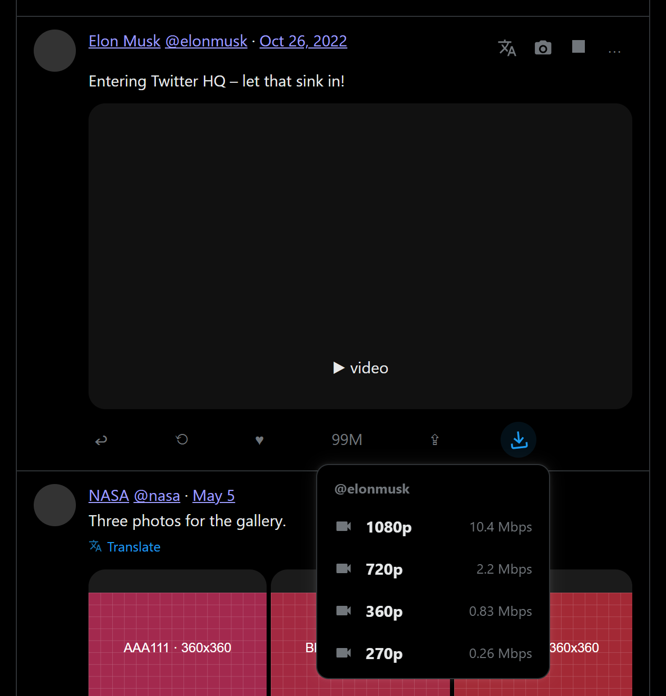
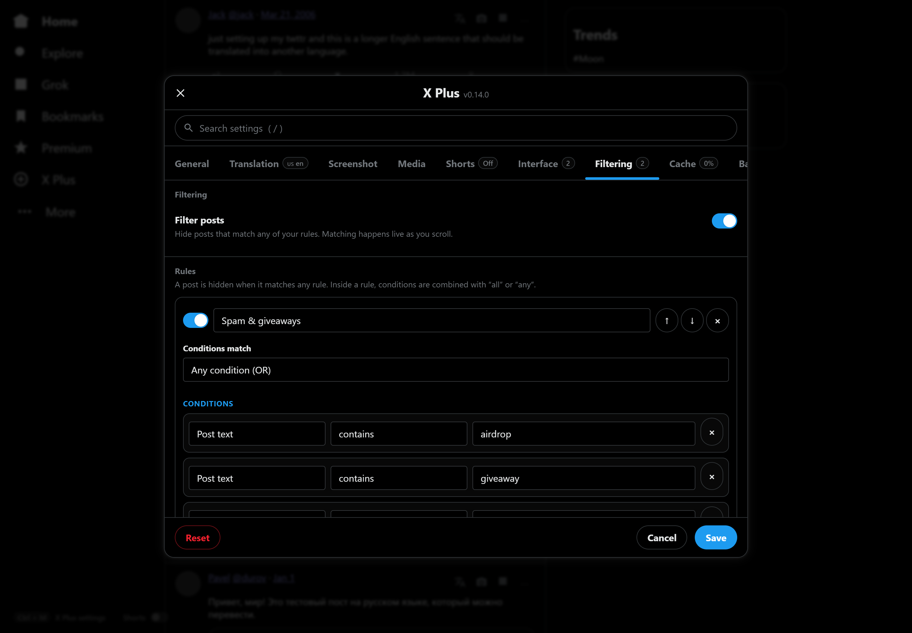

# X Plus

<!-- xp:readme -->
[](https://github.com/NemoKing1210/x-plus/actions/workflows/ci.yml)
[](https://raw.githubusercontent.com/NemoKing1210/x-plus/main/x-plus.user.js)
[](https://github.com/NemoKing1210/x-plus/blob/main/LICENSE)
[](https://github.com/NemoKing1210/x-plus/blob/main/CHANGELOG.md)

[English](https://github.com/NemoKing1210/x-plus/blob/main/README.md) · [Русский](https://github.com/NemoKing1210/x-plus/blob/main/README.ru.md) · **中文** · [Español](https://github.com/NemoKing1210/x-plus/blob/main/README.es.md) · [Português](https://github.com/NemoKing1210/x-plus/blob/main/README.pt.md) · [Deutsch](https://github.com/NemoKing1210/x-plus/blob/main/README.de.md) · [Français](https://github.com/NemoKing1210/x-plus/blob/main/README.fr.md) · [日本語](https://github.com/NemoKing1210/x-plus/blob/main/README.ja.md)
<!-- /xp:readme -->

面向 [X](https://x.com)（x.com / twitter.com）的用户脚本：在帖子原位翻译
（移植自姊妹项目 x-translator）、
下载媒体（视频、GIF、照片）并清理界面——全部集中在一个设置面板中。

同时兼容 X 的新旧两套设计：脚本会识别页面当前使用的布局并自动适配。

> 与 X Corp. / Twitter 无关联。

## 截图

使用本地 X 测试页（模拟帖子）中的已构建用户脚本截取。



| | |
|---|---|
| <br>**翻译** — 原位显示，带*显示原文*、相机按钮，引用的帖子也会翻译 | <br>**Shorts** — 一次一条帖子，箭头按钮，相邻帖子模糊 |
| <br>**媒体下载** — 每个清晰度及码率，或最佳 / 限制分辨率 / 最小 | <br>**过滤** — 规则构建器，可按作者、文本、语言、媒体和标记设置条件 |

此外：X 文章逐段翻译、将帖子复制为 PNG、快速照片画廊，以及悬停即可预览任意清理规则。

## 安装

1. 安装用户脚本管理器：[Tampermonkey](https://www.tampermonkey.net/)、
   [Violentmonkey](https://violentmonkey.github.io/) 或
   [ScriptCat](https://scriptcat.org/)。
2. 通过 raw 链接安装（脚本会从 `main` 分支自动更新）：

```
https://raw.githubusercontent.com/NemoKing1210/x-plus/main/x-plus.user.js
```

| 管理器 | 安装方式 |
|--------|----------|
| Tampermonkey | 管理面板 → **实用工具** → **从 URL 安装** |
| Violentmonkey | 管理面板 → **+** → **从 URL 安装** |
| ScriptCat | 用 raw 链接**从 URL 安装** |
| 手动 | 打开 `x-plus.user.js`，复制内容，新建脚本并粘贴 |

可以从 X 左侧菜单中的 **X Plus** 项或用户脚本管理器的菜单打开设置。

## 功能

### 翻译

与 [x-translator](https://github.com/NemoKing1210/x-translator) 使用同一引擎：

- 每个帖子、回复和引用帖的标题栏中都有**翻译**按钮
- **X 文章**：文章标题栏中（Grok 旁边）的翻译按钮会逐段翻译文章（包括
  标题、列表和图注）——链接、换行和加粗小标题都会保留；译文显示在每个
  段落下方或原位
- 模式——点击按钮翻译，或帖子一出现在屏幕上就**自动**翻译（可只对选定
  账号生效）
- 显示——**替换**原文（默认），或使用单独面板，支持*显示原文*、*悬停查看
  原文*或*原文 + 译文分栏*视图
- 服务商——Google（无需密钥）、DeepL、Microsoft、OpenAI 兼容、Yandex、
  LibreTranslate
- 按账号黑名单、原文语言允许 / 阻止列表、跳过 X 已自动翻译的帖子、帖子
  ⋮ 菜单中的选项
- 翻译错误（“翻译失败，请重试。”）默认隐藏——打开开关即可恢复显示
- 链接和表情符号不会损坏：URL 和话题标签在翻译后保持原样
- 带 TTL 的本地缓存、用量指示器和软性容量上限

### 截图

- 帖子标题栏中**翻译**按钮旁的相机按钮：点击一次即可把帖子——按页面上的
  样子，包括当前主题、译文、媒体、引用和操作栏——作为 PNG 复制到剪贴板
- 背景可配置：页面主题（默认，因此 PNG 永远不会透明）、白色、黑色、透明或
  任意 CSS 颜色
- 图片缩放（自动、1×、2×、3×），保留或裁掉操作栏，复制到剪贴板或保存文件
- 视频和 GIF 以其封面帧截取
- 当浏览器无法把图片放入剪贴板时（Firefox），PNG 会改为保存为文件
- 默认关闭

### 媒体下载

- 帖子操作栏中的按钮，以及（可选）每个视频 / 照片上的按钮
- 视频、GIF 和照片；包含引用帖
- 视频质量：最佳、最高 1080 / 720 / 480p、最小文件，或**每次询问**（选择器
  会列出所有码率版本）
- 照片以原始或大图质量下载；每张照片都可下载或复制为 PNG 到剪贴板；多个文件时可询问或全部下载
- 文件名模板：`{user}` `{id}` `{date}` `{time}` `{n}` `{quality}` `{type}`
  `{text}`
- 进度提示；无需登录即可通过 X 的公开 syndication 端点工作，对于它不返回的
  帖子会回退到你的会话
- 浏览时间线时可选加载更大的照片；切回“默认”（或关闭媒体功能）会恢复 X
  自己的图片版本
- 照片画廊（可选）：点击帖子中的照片会打开快速全屏画廊，而不是 X 的照片
  页面——不加载回复或时间线；显示帖子的所有照片和缩略图（可用滚轮横向滚动），
  支持 `←` / `→`、
  滑动、缩放、下载、复制到剪贴板和打开原图（Ctrl / Cmd / Shift 单击仍会打开 X 的查看器）
- 照片查看器缩放：滚轮、拖动、双击、`+` / `-` / `0`，触摸屏上支持双指缩放

### 短视频式模式

像 YouTube Shorts 一样一次浏览一条帖子（可选）。

- 鼠标滚轮或 `↑` / `↓`（也可用 `J` / `K`）跳到上一条 / 下一条帖子并将其
  居中（`Space` 向前，`Shift` + `Space` 向后）
- 自动翻译（翻译 → 自动模式）可以限制在当前帖子——帖子在中间停留片刻后才
  开始，因此快速划过的帖子不会消耗 API 请求；下一条帖子可以提前翻译（一次
  请求，在你到达之前不显示任何内容），切换瞬间完成（默认开启；“翻译”按钮
  在所有地方仍然可用）
- 只有当前帖子中的视频会播放：相邻帖子中的视频保持暂停，离开某条帖子时其
  视频会暂停（回来时继续播放）
- 当前帖子旁的圆形 ↑ / ↓ 按钮可用鼠标切换到上一条 / 下一条帖子
- 由主题线连接的帖子（回复及其上方帖子、自己的主题串）视为一条帖子：它们会
  一起高亮、居中和切换
- 当前帖子略微放大，周围帖子变模糊；大小、模糊、上一条 / 下一条帖子的透明度
  和过渡速度均可调整
- 自动滚动（可选）：在设定时间（1–60 秒）后自动移到下一条帖子；比这更长的
  视频会保持自己的帖子，直到真正播放完毕（延迟开始、缓冲或拖动进度都不会让
  它提前跳走），倒计时在指针位于箭头按钮上时暂停。暂停视频会暂停倒计时，
  暂停自动滚动会暂停视频；继续后两者都会恢复。进度以下一条按钮周围的圆环
  显示，隐藏按钮时则显示为帖子顶部的进度条；指示器可在设置中切换；播放 /
  暂停按钮位于箭头下方，按键（默认 `P`，可在设置中更改）可暂停和继续自动
  滚动——进度条旁的小标签会显示该按键；暂停状态会被记住，因此打开帖子再
  返回或重新加载页面后仍然保持（关闭再开启自动滚动会重新开始运行）
- 在设置（短视频式标签页）中或左下角 `Ctrl + M` 提示旁的开关中启用
- 适用于信息流（主页、个人资料、搜索、列表），不适用于帖子页面；高于屏幕的
  帖子会正常滚动，直到到达边缘

### 界面

基于开关的清理规则：推广帖子、浏览量、认证徽章、Grok 按钮、发帖框和信息流
标签页、X 插入时间线的*推荐关注*区块、右栏（搜索、Premium 推广、趋势、
*推荐关注*、页脚链接）、左侧菜单项（徽标、探索、通知、聊天、通话、Grok、
历史记录、创作者工作室、Premium、发帖按钮、账户菜单……）以及浮动的 Grok /
聊天面板，还有将鼠标悬停在名称或头像上时出现的个人资料迷你卡片。将鼠标悬停
在设置上即可预览：变暗和模糊会淡出，面板后方页面上受影响的元素会被描边（即使
当前隐藏也会显示）。

在「常规」中开启启动开场后，脚本启动时会播放一段简短开场：页面被短暂冻结，
同时应用设置，然后屏幕上的帖子依次淡入——清理效果和注入的控件绝不会突然出现。
开场默认关闭，并遵循 `prefers-reduced-motion` 偏好。

单独的**帖子**部分用于设置单条帖子及其各部分：帖子卡片样式（描边、填充或
阴影，可调圆角）、帖子间距、内边距、无分隔线、文字大小、头像形状（圆形、
圆角或方形），以及隐藏头像、引用帖、图片、视频、链接预览、文章、“原文语言”
提示、@用户名、操作栏、浏览量、认证徽章和 Grok 按钮。

### 过滤

用于隐藏不想看到的帖子的规则构建器，与界面清理分开。

- 帖子匹配**任意**一条规则时隐藏；规则内部的条件按**全部**（AND）或
  **任意**（OR）组合
- 条件可针对作者名、@用户名、帖子文本、语言、媒体（照片、视频或 GIF）、
  附件（链接卡片、引用帖、投票、文章）和标志（推广、认证作者、转推 / 置顶
  上下文）
- 文本运算符：包含 / 不包含、完整单词、开头是 / 结尾是、完全等于 / 不等于、
  为空 / 不为空、正则表达式
- 支持表情符号：作者名或帖子文本中的旗帜或表情符号会按你看到的样子匹配
- **在此页面测试**会在保存前描边并统计匹配的帖子——包括已经隐藏的帖子
- 滚动时实时隐藏，并移除整个帖子单元格，不会留下空白；帖子页面中正在查看的
  帖子永远不会被隐藏
- 总开关和每条规则的单独开关

### 设置

- 用 **Ctrl + M** 打开 / 关闭（左下角有淡淡的提示；可在“常规”中关闭），也可
  通过左侧菜单项或用户脚本管理器菜单打开
- 标签页：**常规 · 翻译（含服务商） · 媒体 · 短视频式 · 界面 · 过滤 · 缓存 ·
  备份 · 关于**；修改先暂存，点击**保存**后应用
- 界面语言：English、Русский、中文、Español、Português、Deutsch、Français、
  日本語（或自动）
- 通知：开 / 关、位置、显示时长
- **备份：**将所有设置导出 / 导入为 JSON，重置为默认值

## 限制

- 文章翻译会保留链接、换行和**整行**的加粗 / 斜体；句子中间的加粗或斜体
  单词在译文中显示为普通文本。
- 只能保存 **MP4** 版本。X 仅以 HLS 流发布且没有 MP4 的视频会提示无法下载。
- 受限帖子的 GraphQL 回退方案依赖 X 的内部 API，X 更改后可能失效；主路径
  （syndication）不会。
- X 经常更改页面结构。如果按钮、隐藏规则或位置失效，需要调整的选择器列在
  [docs/DEVELOPMENT.md](docs/DEVELOPMENT.md#verifying-x-selectors)。
- 翻译请求会从你的浏览器发往你选择的服务商（默认 Google）。API 密钥保存在
  用户脚本存储中——它们会包含在 JSON 导出里，请妥善保管该文件。

## 开发

```bash
npm install
npm run build      # 构建并刷新根目录的 x-plus.user.js / x-plus.meta.js
npm run ci         # i18n 与 README 检查 + 构建 + 产物校验
npm run harness    # 用于手动测试的 x.com 模拟页面
```

架构、如何添加功能 / 服务商 / 清理规则以及发布清单：
[docs/ARCHITECTURE.md](docs/ARCHITECTURE.md)、
[docs/DEVELOPMENT.md](docs/DEVELOPMENT.md)、[AGENTS.md](AGENTS.md)。

## 许可证

[MIT](LICENSE)
